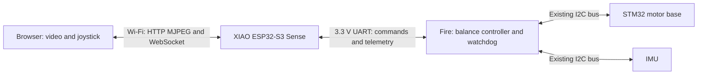

# ESP32-S3 Sense video and browser control for BALA2 Fire

Development design, 2026-10-18. This is an implementation guide, not tested robot firmware.
Assumed hardware: **Seeed Studio XIAO ESP32-S3 Sense** and **M5Stack BALA2 Fire**.
An arbitrary ESP32-S3 camera board requires a different pin map.

## Recommended architecture

Use the XIAO for Wi-Fi, a locally hosted joystick page, JPEG video streaming,
and command forwarding. Keep IMU acquisition, balancing, motor limits and fault
handling on the Fire. Keep the existing STM32 motor-base firmware/interface.
Use **115200-baud UART remapped to Fire Port B (RX36/TX26)** for commands and
telemetry. This is a design recommendation subject to checking your actual board
revision and attached accessories.

The browser sends desired forward/turn inputs, never raw motor PWM. Video is
best effort; a slow video viewer must not delay control. No laptop server is
required after deployment.

Read in order:

1. [Hardware and interface selection](HARDWARE.md): port conflicts, wiring, power, alternatives.
2. [Implementation guide](IMPLEMENTATION.md): firmware modules, browser behavior, protocol and staged bring-up.
3. [Validation checklist](VALIDATION.md): measurable acceptance tests and fault injection.

## Repository starting point

The actual projects currently live at:

- `.devcontainer/firmware/bala2/`: Arduino/PlatformIO `m5stack-fire`; starter `main.cpp` only.
- `.devcontainer/firmware/camera/`: Arduino/PlatformIO `seeed_xiao_esp32s3`; `main.cpp` is commented out, including `setup()`/`loop()`.

Neither project currently implements this design. Both use an unpinned
`espressif32` platform. The camera project needs real entry points before a
successful application build. Earlier [environment guidance](../DEVELOPMENT_SETUP.md)
uses proposed `firmware/...` paths; use the actual paths above for this work.
No relocation is required.

## Design decisions and open checks

| Topic | Decision / check |
| --- | --- |
| Robot link | Remapped hardware UART on Port B; preserve Fire PSRAM |
| Network | Password-protected XIAO access point first; station mode later |
| Video | MJPEG over HTTP, initially QVGA and one viewer |
| Commands | WebSocket at 20 Hz; bounded UART frames; Fire owns command expiry |
| Control | Preserve proven local balance loop; introduce limited velocity/yaw references |
| Hardware checks | Board/sensor revision, Port B continuity, spare pin ownership, power budget |
| Software checks | Pin tested framework/library versions; verify PSRAM, USB console and camera config |
| Release status | Documentation only; compilation, electrical checks and robot tests pending |
